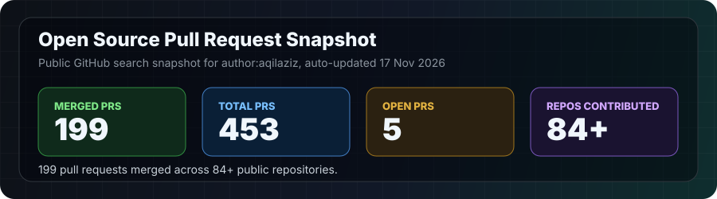

# Hi, I'm Aqil Aziz

I build practical web applications and explore AI tools for education and everyday work in Indonesia.

## About

- Educator at MAM 1 Paciran, Lamongan, East Java.
- Working with TypeScript, JavaScript, React, Next.js, and Supabase.
- Interested in AI-assisted learning, developer tools, and Indonesian localization.

## Selected projects

| Project | Focus |
| --- | --- |
| [BeasiswaCoach AI](https://github.com/aqilaziz/beasiswacoach-ai) | Scholarship planning and AI-assisted coaching for Indonesian students. |
| [MAMSAKA Student Portfolio](https://github.com/aqilaziz/buildaimamsaka) | A Next.js and Supabase platform for student profiles and project portfolios. |
| [GeraiCerdas AI](https://github.com/aqilaziz/geraicerdas-ai) | An Indonesian MSME dashboard and AI copilot, adapted from FinBoard with attribution in the project README. |

## Open source

My work includes contributions and pull requests in AI tooling, documentation, localization, and testing. The project discussions document review status, implementation details, and test evidence.

## Pull request snapshot

This dated snapshot is generated by a scheduled GitHub Actions workflow. Counts can differ from signed-in views because search scope and refresh times differ.

## Connect

[LinkedIn](https://www.linkedin.com/in/aqil-aziz-0489a014a/) · [GitHub](https://github.com/aqilaziz)
